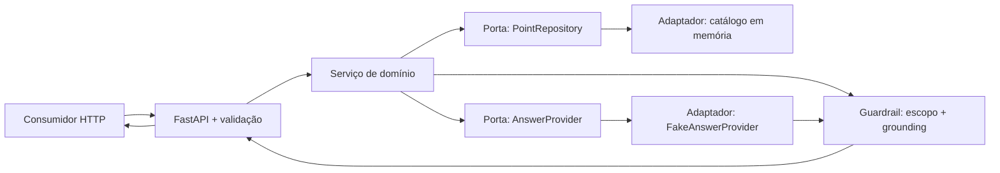
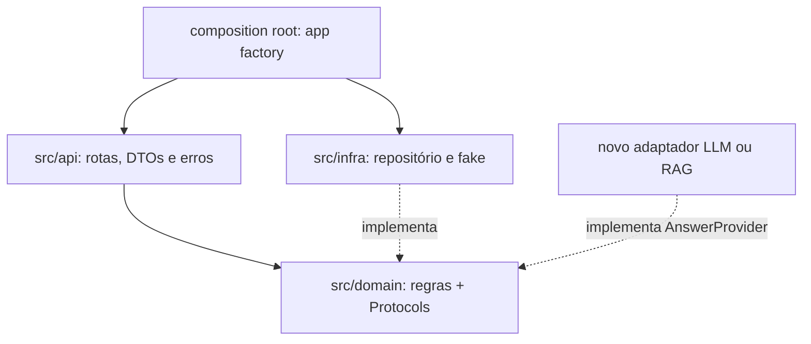

# Arquitetura — EcoPontos Cidadãos

## Componentes e dados

*O adaptador fake é determinístico e não faz chamadas ao LLM; habilita testes reproduzíveis. No produto real, a porta `AnswerProvider` recebe novo adaptador, com timeout e isolamento de rede.*

## Portas e adaptadores / dependências

A dependência do domínio aponta **somente para abstrações** `PointRepository` e `AnswerProvider`, definidas em `src/domain/ports.py`; o domínio não importa SDK de LLM. A configuração de composição decide o adaptador: `AI_PROVIDER=fake` (padrão); outro valor não homologado falha explicitamente ao iniciar, nunca finge integrar um modelo. Um adaptador real futuro substituiria uma única escolha de provedor no composition root após implementar `generate(point, question)` — sem mudar regra de domínio.

## Fluxo do POST /ask
1. Pydantic valida limites do payload; FastAPI devolve 422 com `ErrorResponse`.
2. Serviço busca `point_id` no repositório; ausência retorna 404.
3. Guardrail de escopo e resíduos especiais identifica temas suportados; fora do escopo retorna recusa sem tocar no provedor.
4. `AnswerProvider` produz texto estruturado a partir do cadastro, sendo o fake determinístico.
5. Guardrail pós-processamento aplica resposta derivada do catálogo: o serviço gera a redação factual final, sem confiar em texto livre do provedor. Falha da porta vira 503.
6. API serializa `AskResponse`. A origem é rastreada por `source_point_id`.

## ADR-001 — Portas/adaptadores versus LLM acoplado
- **Contexto:** prefeitura precisa trocar provedor sem alterar regras nem quebrar teste.
- **Opções:** (A) SDK do modelo na rota; (B) abstração `AnswerProvider` no domínio e injeção no app.
- **Decisão:** B. O contrato de domínio recebe ponto conhecido e pergunta e retorna intenção estruturada, não texto autoritativo.
- **Consequência:** testes com fake, substituição independente; mais uma interface e trabalho de implementação por provedor.

## ADR-002 — Fonte estruturada + recusa versus resposta aberta
- **Contexto:** respostas públicas não podem inventar pontos, materiais ou perigos de descarte.
- **Opções:** (A) prompt aberto; (B) RAG com documentos públicos; (C) catálogo local como verdade + guardrails.
- **Decisão:** C no slice; reavaliar B após ingestão oficial e governança documental.
- **Consequência:** alta reprodutibilidade e respostas limitadas; pouca flexibilidade fora do cadastro.

## ADR-003 — Falso LLM documentado em vez de integração não testada
- **Contexto:** prazo curto, credenciais de terceiros não disponíveis, avaliação exige CI sem rede.
- **Opções:** API paga com dependência de chave, Ollama local pesado, fake implementado.
- **Decisão:** fake de intenção, isolado atrás de porta. Não afirmar que o fake mede precisão de um LLM real.
- **Consequência:** demonstra desenho e fluxo end-to-end, porém rollout para cidadãos fica bloqueado até eval com modelo real e dados oficiais.

## Observabilidade e SLOs propostos
| Sinal | Medição operacional | Alerta |
|---|---|---|
| latência HTTP por rota | histogramas `http_request_duration_seconds`, p95 | p95 GET > 400 ms por 10 minutos |
| erro HTTP 5xx | contagem por rota | > 1% em janela de 5 minutos |
| recusa de IA | `ai_refusal_total / ai_requests_total` | > 20% em 30 minutos (investigar mudança de tráfego) |
| disponibilidade do provedor | `ai_provider_error_total` | ≥ 3 erros em 5 minutos |
| tokens e custo | uso reportado por adaptador real | orçamento diário > R$ 50; fake consome 0 tokens |

Estas métricas são um **plano de instrumentação**, não coleta efetiva do protótipo. No slice há logs básicos da aplicação via Uvicorn; alertas e painéis exigem stack de observabilidade antes de produção.

## Segurança e operação
- **Entrada:** Pydantic restringe formatos e tamanhos; filtros enumerados; rejeição 422; 400 para pergunta semanticamente vazia após trim.
- **Sanitização:** saída do modelo nunca é enviada crua ao usuário; sem HTML, sem interpolação de SQL; mensagens de erro não vazam traceback.
- **Dados:** somente cadastro fictício; nenhuma coleta de IP ou dado pessoal no domínio; não usar o cadastro como fonte oficial.
- **Segredos:** nunca salvar API key, `.env` real nem token no Git; variáveis via ambiente e secret store no futuro.
- **Versão / evolução:** mudanças de contrato incompatíveis precisam de versão de API, teste de regressão e validação antes da publicação.
